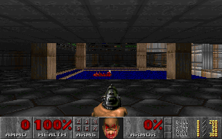

# SQLDoom on ASQL

A port of [SQLDoom](https://github.com/cedardb/sqldoom) (CedarDB; GPL-2.0, see `LICENSE`, which covers this directory)
to ASQL: Doom's renderer and game state in SQL, MySQL's dialect, run by aios's own engine. SQLDoom's Python parts are
grain here. Ported from upstream commit `95753a20e403d0658e624f623f972eb1f708deed`.

## Loading a WAD

```bash
aios --root R grain run --steps 0 apps/sqldoom/load.gr doom1.wad E1M1
```

`load.gr` (SQLDoom's `wad_loader.py` and `wad_sql.py`) makes database `doom`, applies `sql/schema.sql`, the import
procedures (`sql/loader_procs.sql`), the light functions (`sql/render_light.sql`), the game tic (`sql/gametic.sql`)
and the static catalogs (`sql/game_data.sql`, `sql/menu_data.sql`), decodes the WAD's palettes, COLORMAP, wall
textures, flats, status-bar patches, sprites, sound effects (as WAV) and music (MUS, and MIDI made from it), loads
each map asked for (all of them when none is named), and builds the derived tables (`sql/derived.sql`). E1M1 from the
shareware `doom1.wad` loads in about 40 s. `install_tic.gr` reinstalls just the game tic.

## Playing

```bash
aios --root R grain serve apps/sqldoom/play.gr [MAP] [skill]
```

`play.gr` (SQLDoom's `doom_client.py`, one player) starts the map as SQLDoom's client does (`doom_reset_stage`,
`doom_spawn_player`), runs `doom_run_game_tic` 35 times a second from the keys held, reads SQLDoom's per-tic snapshot
(`sql/client/game_tick_finish.sql`) for exits and death, and draws each frame with the renderer at the camera
`sql/client/camera_pose.sql` interpolates between tics. `aios grain serve` shows the pane in a browser (`aios grain
run` has no display); `SQLDOOM_FRAMES=n` runs n tics and frames with no display and saves the last.

It is not playable at speed: a tic takes 25-45 ms with the monsters asleep and over 100 ms once they chase (Doom's
budget is 28.6 ms), a frame about 1.2 s.

## Rendering a frame

```bash
aios --root R grain run --steps 0 apps/sqldoom/render.gr out.png [MAP [x y z angle]]
```

`render.gr` sets the renderer's parameters (`@map_id`, `@player_thing_id`, `@skill`, `@x`, `@y`, `@z`, `@angle`),
runs `sql/renderer.sql` - SQLDoom's whole renderer, one statement - and saves the 320x200 frame it returns. With no
pose the camera is at player 1's start:



The game tic, renderer and client run E1M1: a scripted 400-tic run walks, turns, fires and uses with no error,
monsters wake, chase and shoot, a door moves. It takes about 1.2 s a frame after the first (SQLDoom on CedarDB:
about 13 ms). The engine work the renderer drove so far, all of it general: CTEs read once are merged into their
reader as views and the rest have their rows appended in bulk; a multi-column `EXISTS` is decorrelated into a
row-value `IN`, hashed as whole tuples; expressions over integer, DOUBLE and dictionary-coded text columns compile
into vectorized programs run over whole row sets (aggregate arguments, GROUP BY keys, join keys, select items,
pushed-down WHERE and ON conjuncts, the light functions inlined); join steps pick the key that selects and hash
expression keys in lanes; doubles print through `std::to_chars`. What is left is the floor of materializing each
CTE as rows of text before the next reads it - `fragment_union` alone is 78,000 rows - and the texel joins of the
floor and ceiling chain over some 56,000 rows; real time needs CTEs kept as typed columns end to end, a change to
the engine of its own. `AIOS_CTE_MERGE_TRACE=1` prints each CTE's time, `AIOS_VX_TRACE=1` each join step's.

## What differs from SQLDoom

- **Dialect.** Enum types are inline `ENUM(...)` columns, `BYTEA` is `LONGBLOB`, `SERIAL` is `AUTO_INCREMENT`,
  `ON CONFLICT` is `ON DUPLICATE KEY UPDATE` / `INSERT IGNORE`, `E'..' || E'..'` is one literal.
- **Materialized views** (`sector_adjacency`, `linedef_geom`, `node_path_steps`, `ui_hud_pixels`, `ui_static_pixels`)
  are tables `derived.sql` rebuilds after an import. `node_path_steps` walks up from each subsector instead of
  collecting PostgreSQL arrays on the way down.
- **Texels as rows.** `walltex_texels`, `flat_texels` and `sprite_texels` hold the texels the BYTEA columns hold, one
  row each, which is what the renderer joins on, by one packed integer key (`id * 2^20 + v * 2^10 + u`): ASQL
  indexes a join column by column, so a join on (name, u, v) checked thousands of candidates per pixel.
- **The renderer** (`sql/renderer.sql`, whose header lists every change): MySQL casts and `DIV`; texel joins instead
  of `GET_BYTE`; the top-1 `LEFT JOIN LATERAL`s as window functions; `BOOL_AND`, `ARG_MAX`, `string_agg`, `||`,
  `IS DISTINCT FROM` and `FULL JOIN` in their MySQL forms; parameters as session variables. The light functions
  (`sql/render_light.sql`) are stored functions.
- **The game tic** (`sql/gametic.sql`) is SQLDoom's CedarScript as ASQL stored functions, its SQL left as PostgreSQL
  wrote it: ASQL reads `::`, `ON CONFLICT`, `UPDATE .. FROM`, `DELETE .. USING`, `BOOL_OR`, `ARG_MAX`,
  `string_agg`, `FILTER`, `LATERAL` and `generate_series` (docs/asql.md, "PostgreSQL's spellings"), and the functions
  are made under `sql_mode` `PIPES_AS_CONCAT,PG_DIVISION` so `||` and `/` mean what they do there.
  `tools/cs2my.py` converted the procedural layer (`let`, `if {}`, `SELECT .. {block}` to `DECLARE`, `IF`, a cursor
  loop); by hand: `doom_prandom` (PostgreSQL's `#` xor), a `^` power, the stairs builder's visited-sector array, the
  hitscan's `INSERT .. RETURNING` inside a `WITH`, and a `SELECT generate_series(..)` in a select list.

## Not ported yet

- Speed: CTEs as typed columns, and the tic's per-statement cost, in the engine (see above).
- The client's other screens - title, menus, intermission, finale, automap (`sql/client/render_screen.sql`,
  `render_automap.sql`) - and sound playback; music is not rendered to audio (SQLDoom uses an external synthesizer).
- Deathmatch (`39_mp.sql`, `42_api.sql`): the functions are installed but not run; they use `session_user`, roles,
  `interval` and `EXTRACT(EPOCH ..)`.
- `render.gr` still puts a `player_state` row with the schema's defaults there when the tic has not spawned the
  player (hence the 0 ammo in the picture above).
