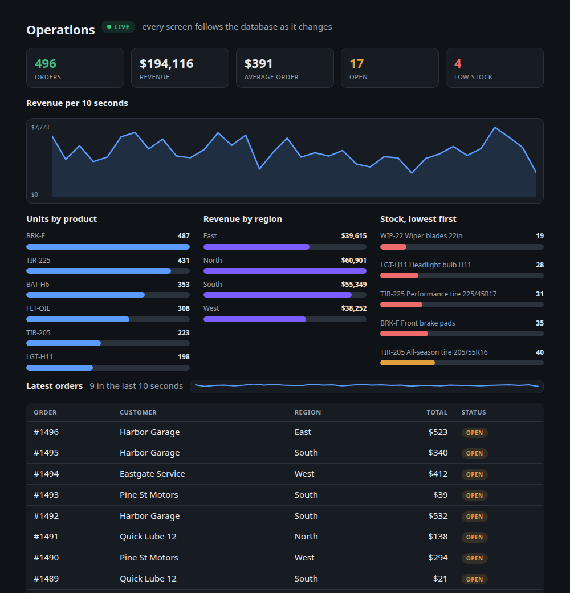

# grain

A small, fast, embeddable language: closures, first-class functions, lists and
maps, integers that stay integers, a standard library with files, processes,
sockets, JSON, hashing and a 2D canvas, and AArch64 and x86-64 JITs. It is aios's own
language and also runs on its own on macOS, Linux and Windows.

```grain
fn fib(n) {
  if n < 2 { return n }
  return fib(n - 1) + fib(n - 2)
}
print("fib(30) =", fib(30), "on", sys.os)
```

## Using it

```
grain hello.gr [args...]     run a program (args holds what follows)
grain repl                   read and run lines until EOF or .quit
grain eval "1 + 2 * 3"       run one line and print its value
grain check *.gr             compile only and report every error
grain dis hello.gr           show the bytecode the compiler emitted
grain --steps 1000000 ...    stop a program after that many instructions
grain --no-jit ...           interpret everything
grain --safe ...             native fn on bytes only: no ptr, extern fn, ffi or plugins
GRAIN_PROFILE=1 grain ...    samples the CPU time per source line and prints the top 40 lines to stderr at exit
GRAIN_PROFILE=native grain ...   the same, and writes each sample's C++ call stack (hex addresses) to GRAIN_PROFILE_OUT
```

Exit status: 0 the program ran to its end, 1 it did not compile, 2 it stopped
on a runtime error, 64 the command line was wrong. A first line starting with
`#!` is a comment, so `#!/usr/bin/env grain` makes a script executable.

## The standard library

| Area | Functions |
|---|---|
| The machine | `sys` (`os`, `arch`, `cpus`, `memory`, `host`, `version`), `args`, `getenv`, `setenv`, `cwd`, `sleep(ms)` (milliseconds), `clock`, `time_us` |
| Numbers | `a..b` is `range(a, b)`; `/` always gives a real (`7 / 2` is `3.5`); `idiv(a, b)` is whole-number division, truncating toward zero like `%` (`idiv(-7, 2)` is `-3`); integers only, and zero is an error |
| Decimals | `decimal("19.99")`, `decimal(x, places)`, `dec_div(a, b, places)`, `scale(d)`, `decimal_prefix(s)` (the number a string starts with: `{d, whole}` or nil), `round_sig(d, n)`, `number_format(v, places, point, sep)` (PHP's: `number_format(1234.5678, 2)` is `"1,234.57"`); `+ - * / %`, comparisons, `round`, `floor`, `ceil`, `abs`, `min`, `max`, `format("{:.2f}", d)` all take them; exact, half-up, 38 digits |
| Files | `read_file`, `write_file`, `append_file`, `list_dir`, `delete_file`, `file_exists` (relative to the working directory) |
| Paths and directories | `path_join`, `basename`, `dirname`, `extname`, `path_normalize`, `abspath`, `mkdir`, `rmdir`, `is_dir` |
| Processes | `sys_exec(command)` through the system shell, `exec([program, args...])` without one: `{ok, code, output}` |
| Network | `http_get`, `http_post`, `http_request` (HTTP and HTTPS with certificate verification, redirects); TCP/UDP sockets; a small server (`listen`, `accept`, `read_until`, `write`) |
| Strings | escapes `\n \t \r \0 \a \b \f \v \e`, `\xHH` (one byte), `\u{1F600}` (a code point, as UTF-8); `utf8_valid(text or bytes)` |
| Text | `format("{:>8.2f}", x)`, `regex_test`, `regex_match`, `regex_find_all`, `regex_replace`, `regex_split` (ECMAScript patterns), `upper`, `lower`, `trim`, `split`, `join`, `replace`, `pad_left`, ... |
| Data | `json_parse`, `json_stringify(v, {indent, ascii, escape_slashes})` (ascii: `\uXXXX` past ASCII; escape_slashes: `\/`; both is PHP's `json_encode`), `base64_*`, `hex_*`, `url_*`, `sort_by`, `group_by`, `key_by(list, fn)` (first item per key), `sum_by(list, key_fn, value_fn)`, `map`, `filter`, `reduce`, `zip`, `enumerate`, ... |
| Numbers in text | `is_numeric(v)` (a number, or a string that is one and nothing more), `to_number(v, [default])` (a string by the number it starts with: `to_number("12.50abc")` is `12.50`) |
| Time | `now`, `date_format`, `date_parse` (ISO 8601), `date_parts`, `date_make` - computed by grain, so a date prints the same on every OS |
| Digests and ids | `sha256`, `sha1`, `sha512`, `sha384`, `md5`, `keccak256`, `hmac_sha256`, `uuid`; `aes_cbc_decrypt(key, iv, data)` (PKCS#7, what `openssl_decrypt` reads; nil when the padding is wrong) and `hash_equals(a, b)` (in constant time, for secrets) |
| Errors | `error(message)`, `pcall(fn, args...)` -> `{ok, value, error}` |
| Every core | `parallel_map(list, fn)`, `spawn(fn, args...)` -> task, `await(task)`, `task_done(task)` |
| Graphics | a 2D canvas: shapes, gradients, text, images, effects, widgets; saved as PPM or bytes |
| Windows | `create_pane({title, width, height, on_draw, on_event, on_click, on_key})`, then `run_panes()` |
| Widgets | `ui.column`, `ui.row`, `ui.text`, `ui.button`, `ui.field`, `ui.table`, `ui.tile` in a `ui.pane` |

## Live data

Write the data, write the view, and the screen follows the data. Nothing in the
program sends, polls, listens or says how to update.

```grain
let seconds = 0
every(1, fn () { seconds = seconds + 1 })       # the data changes on its own

ui.pane({"title": "Live", "shared": true, "view": fn () {
  return ui.tile("Seconds up", seconds)          # the view just reads it
}})
run_panes()
```

`every(seconds, fn)` and `after(seconds, fn)` make data that changes by itself
(`cancel(id)` stops one; `wait(seconds)` sleeps while they fire, for a script with
no window). Whatever runs the program fires them: a window's frame loop, `grain
serve`, aios-webserver. A window redraws every frame, so a change shows at once.
For a browser or a native client the server does the watching: when the data
behind a view changes - a timer, another viewer pressing a button, anything - the
widgets are re-rendered, and if the screen is different every viewer is sent it
(server-sent events, to a browser and to `grain open` alike; a native client asks
only when a server will not stream). A change that does not alter the screen sends nothing.

A pane made with `"shared": true` is one copy of the program for everyone, so
every viewer sees the same live data and one viewer's change reaches the others
as it happens (`examples/live.gr` is a clock and a message board that does just
that). Without it each visitor has a copy of their own, as before.

A view that reads the clock instead of data (an uptime computed inside `view`)
has nothing that changes, so give the pane `"refresh": n` and the server looks
again every n seconds. `examples/live.gr` is the model: data that changes, a
view that shows it.

## Streams a server pushes

```grain
let id = events("https://example.com/feed", {"headers": {"authorization": token}}, fn (data) {
  latest = json_parse(data)          # each event's data, on the program's own thread
})
events_close(id)
```

`events` holds a server-sent-events connection on a thread of its own (HTTP or
HTTPS, chunked or not) and hands each event's data to the function as it
arrives, through the same loop that fires timers - a window's frames, `grain
serve`, the web server, or `wait()`. A dropped connection is made again a second
later; a refused one is reported once, as `{"error": ...}`. `grain open` follows a
served program this way: the server pushes the new widgets and the window draws
them, with nothing asked.

## Every core

```grain
let sizes = parallel_map(files, fn (f) { return len(read_file(f)) })   # map(), over every core
let t = spawn(fn (n) { return fib(n) }, 32)                            # runs while the program goes on
...
print(await(t))                                                        # its result, once it has one
```

`parallel_map(list, fn)` is `map(list, fn)` with the calls spread over as many
threads as the machine has cores: the same results in the same order. `spawn(fn,
args...)` starts one call on another core and returns a task; `await(task)` waits
for it and gives back what it returned (or raises its error), and `task_done(task)`
says whether it has finished. A task never awaited still runs to its end before
the program does.

Each worker is a VM of its own. The function goes to it with what it can reach -
its arguments, what its closure captured, the globals its code names - copied
as they are when the work starts, and only the result comes back. So nothing two
workers do can collide, and a worker that changes a list it was given, a global
or a captured variable changes its own copy; the program sees what the function
returns. A socket, a database connection, a task, a channel or an entity cannot
be copied and is refused by name (open the connection inside the function), and
a worker has no loop of its own, so `every`, `after`, `live`, `events` and
`run_panes` refuse there. What a worker prints appears when its result is
collected: `parallel_map`'s in item order, a task's when it is awaited.

24 calls of `fib(30)` on a 12-core Mac (6 performance, 6 efficiency cores),
interpreted: `map` 3.0-3.4 s, `parallel_map` 0.66-0.70 s. See [**`examples/grain/parallel_pool.gr`**](../examples/grain/parallel_pool.gr) for a complete concurrency walkthrough.

## Databases, and live query results

`examples/ops_board.gr` is the whole idea in one program: an operations board over
ASQL queries that every window and browser keeps current as `examples/ops_feed.gr`
plays a busy store. The board has no code that sends, polls or listens.



```grain
let db = db_connect("127.0.0.1", 3307, "erp", password, "versioneight")   # ASQL, MariaDB or MySQL
let r = db_query(db, "SELECT stockid, description FROM stockmaster LIMIT 5")
r.rows        # [["A-1", "Widget"], ...]   (strings; nil for NULL)
r.records     # [{stockid: "A-1", description: "Widget"}, ...]

let late = live(db, "SELECT orderno, debtorno FROM salesorders WHERE late = 1")
ui.table(late.records)    # stays current; nothing else to write
```

Values go in as parameters, never pasted into the SQL: each `?` is filled with
the next value of a list, quoted for you. A string is escaped, `nil` is `NULL`, a
decimal keeps its digits, and a list becomes `a, b, c` for `IN (?)`.

```grain
db_query(db, "SELECT * FROM stockmaster WHERE stockid = ? AND units IN (?)", [id, ["each", "box"]])
db_escape("it's")                     # it\'s  - what mysqli::real_escape_string gives, to build SQL by hand
db_quote(["a", nil, 1])               # 'a', NULL, 1
```

Quoting uses backslash escapes, the default `sql_mode`; a server running `NO_BACKSLASH_ESCAPES` needs the values checked by hand. A `?` inside a string, a quoted name or a comment is left alone, and a query
given no list is sent exactly as written. A big result is built as `rows` and as
`records` unless you say otherwise, which costs twice the time and memory:
`db_query(db, sql, [], {"records": false})` (or `"rows": false`) builds one, and
`{"decimals": true}` returns DECIMAL columns as exact decimals instead of strings
(see below). The options can follow the SQL directly when there are no parameters:
`db_query(db, sql, {"records": false})`.

`db_connect` speaks the MySQL wire protocol itself (`mysql_native_password`, and
`caching_sha2_password`'s fast path), with no client library. `live(db, sql)`
returns a map whose `rows`, `records`, `columns`, `error` and `changes` are
rewritten in place whenever the query's answer changes, so any view reading it
redraws, in a window or in every browser at once. Against ASQL a tick is one
`ASQL_CHANGES()` lookup over the tables the query reads (guessed from its FROM
and JOINs, or given as `live(db, sql, {"tables": [...]})`); the query runs only
when one of them was written. Against another server it runs every tick
(`every`, default 1 second). `live.runs` counts how often the query itself ran.

## Exact decimals

Money is not a real: `0.1 + 0.2 == 0.3` is false for reals in every language, and a
price rounded as a real rounds the wrong way half the time. A decimal is exact.

```grain
let price = decimal("19.99")
let total = price * 3 + decimal("0.05")     # 60.02
round(total / 7, 2)                         # 8.57 - half away from zero, as PHP's round() does
decimal("2.50") == decimal("2.5")           # true: the scale only decides how it prints
format("{:,.2f}", decimal("1234567.891"))   # 1,234,567.89
```

A decimal is an integer mantissa (128 bits, 38 digits) and a scale of up to 30. An
int mixes freely; a real does not, because 0.1 as a real is not 0.1 - say
`decimal(x)` if you mean it (a real becomes the shortest decimal that reads back as
it). `+ - %` take the larger scale, `*` adds the scales (rounding past 30), and `/`
keeps at least 12 places; `dec_div(a, b, places)` picks them. `round(d, places)`
rounds half away from zero. Overflow and division by zero stop the program with an
error rather than answering wrongly. They cross into workers, `json_stringify` and
`db_query(..., {"decimals": true})` with every digit. There is no decimal literal
yet: write `decimal("0.5")`. See [**`examples/grain/decimals.gr`**](../examples/grain/decimals.gr) for exact invoicing, tax calculation, and formatting examples.

## Programs in several files

```grain
import "lib/money.gr" as money               # namespaced module: isolated under money.*
import { calculate_totals as calc_tax } from "lib/tax.gr" # selective aliased import
import "lib/legacy.gr"                       # top-level export
```

Runs another file in the program, once. Using `as alias` groups the module's top-level
functions and variables into a map, avoiding namespace collisions across libraries.
Selective imports (`import { a, b as c } from "file.gr"`) unpack only the requested symbols; asking for a name the file does not define is an error that says so.
The path is relative to the file that imports it (the main program's directory for the
main program); circular imports and diamond dependencies resolve safely. `grain build`
finds the imports and packs them into a single binary.

## An API with no page

```grain
import "lib/pricing.gr" as pricing

serve_routes({
  "GET /health": fn (req) {
    return res_json({"status": "ok", "uptime_s": round(now() - started)})
  },

  "GET /items/:id": fn (req) {
    return res_json({"item_id": req.params?.id, "query": req.query_params})
  },

  "POST /quote": fn (req) {
    let { items } = req.json
    let quote = pricing.calculate(items)
    return res_json(quote, 201, {"X-Quote-Id": uuid_v4()})
  }
})
```

`grain serve api.gr` binds routes to HTTP methods and paths. The request map provides
`req.method`, `req.path`, `req.params` (extracted from `:param` and `*wildcard`), `req.query`,
`req.query_params` (parsed dictionary), `req.json` (auto-parsed payload), `req.headers`, and
`req.remote`. Response helpers (`res_json`, `res_text`, `res_html`, `res_error`, `res_redirect`)
format standard HTTP envelopes and custom headers.

`serve_routes(routes, middleware)` takes an optional list of functions `fn (req, next)`, outermost first. Each
either returns a response itself (a 401, say) or returns `next(req)`, optionally changing the request going
in or the response coming out. Put the header-adding one first and it wraps every response, including the
ones a later middleware cut short.

`res_sse(events)` formats a list of `{"id": ..., "event": "ping", "retry": ..., "data": ...}` maps as `text/event-stream` (one map, or a plain string, is a one-event list). A `data` that is a map or list goes out as JSON, and one with several lines becomes several `data:` lines. Newlines in `id`, `event` and `retry` are dropped, and a plain string is always data, so text from a user cannot add a field or an event. It sends the events as one complete response.

For a response that goes on over time, a route that takes `(req, writer)` (or reads `req.writer`) can write as it goes: `writer.write(text)`, `writer.write_sse(event)`, `writer.write_head(status, headers)`, `writer.header(k, v)`, `writer.status(code)`, `writer.is_closed()`, `writer.close()`. The first write sends the status and headers; `is_closed()` turns true when the client leaves, so a loop that checks it stops instead of working for nobody. See [Writing a Grain application](../docs/grain-app-writing.md#server-sent-events-and-live-streaming).

Each request runs in a worker VM of its own, on its own thread, the way
`parallel_map` workers do: a route that takes eight seconds does not hold up the
others. What follows from that is the workers' rule - the handler and the globals
and functions it names are copied in as they are when the request arrives, so it can
read the program's values but what it changes is its own; a database connection
cannot be copied, so open it inside the handler. Routes that must share the
program's variables run one request at a time with `serve_routes(routes,
{"workers": false})`. The same options work on a page: `ui.pane({"routes": {...},
"workers": true, ...})`. `grain serve --max-body 10m` (or `GRAIN_MAX_BODY`) sets the
largest request body, 1 MB by default; a bigger one gets 413.

## Language ergonomics & stdlib

```grain
# String interpolation, with format specifiers after a colon
let name = "Grain"
let balance = decimal("1234.56")
print($"Hello {name}, balance: {balance:,.2f}")   # Hello Grain, balance: 1,234.56
print($"[{7:>5}] {{braces}}")                      # [    7] {braces}

# Spread (...): a list's items as a call's arguments, or inside a list literal
let params = ["A1", 3]
let rows = read_raw(sql, ...params)               # read_raw(sql, "A1", 3)
let all = [0, ...params, 9]                       # [0, "A1", 3, 9]; spreading anything but a list is an error

# Optional chaining (?.): nil, or anything that is not a map, gives nil instead of an error
let token = req?.headers?.authorization

# Destructuring, in a function as well as at the top level
let { sku, price: cost } = get_product()          # a key, or key: new_name
let [ head, next ] = [1, 2, 3]                    # takes the first two

# Identifiers, timestamps, and lookup that does not fail
let id = uuid_v4()                                # 36 characters, version 4
let ts = iso8601()                                # 2026-10-24T20:43:44Z; iso8601(0) is 1970-01-01T00:00:00Z
let host = get_in(config, ["network", "host"], "127.0.0.1")   # the default when any step is missing
let first = get(items, 0, nil)                    # get(map_or_list, key_or_index, default)

# Worker lifecycle supervision
while not is_stopping() {
  process_queue()
  sleep(1000)
}
```

What it will not do, so you are not surprised:

- Destructuring a list with fewer items than names, or destructuring `nil`, is a runtime error (`index 2 is outside a list of 2`, `cannot index a nil`). A map missing a key gives `nil` for that name.

Compile errors show where, with a caret under the problem:

```
lex_error.gr:2:15: unexpected character '$'
let total = 1 $ 2
              ^
```

Column tracking is supported for both compile-stage and runtime errors; runtime error messages and stack traces report exact column positions and display diagnostic carets.

Other helpers: `random_bytes(n)` (n raw bytes from the operating system's random source, up to 1 MiB; use `hex_encode` or `base64_encode` to print them), `sha256(text)` and `hmac_sha256(key, text)` (hex strings), `hash_equals(a, b)` (for strings of the same length it takes the same time wherever they differ, which is what comparing a token or signature needs), `base64_encode`/`base64_decode`, `hex_encode`/`hex_decode`, and the `regex_*` functions. `assert_eq`, `assert_ne`, `assert_true` and `assert_false` stop a program with a message, which is what tests are written with.

## One program, a window or a web page

A program built from `ui.pane` is written once and runs both ways. The pane's
`view` describes the screen as widgets; a window paints them, and a browser
gets them as HTML.

```
grain counter.gr                   a window (counter.gr: ui.pane + run_panes())
grain serve counter.gr             the same program in a browser, at http://127.0.0.1:8080/
grain build counter.gr -o counter  one file: ./counter is a window, ./counter --web [port] a web page
grain open https://host/app.gr     a program running on a server, drawn in a native window (no HTML)
```

In the browser each visitor gets their own copy of the program (a session, kept
by a cookie; or one shared copy, with `"shared": true`): a button or Enter calls the same grain function it would in a
window, with the field texts, on the server, and the page redraws. State is a
session's own and lives in the program's variables. Your functions, `ui.set_field`
and `ui.field_text` behave as they do in a window. A pane option `"refresh": 5`
makes the server look again every 5 seconds, for a view that reads a clock
instead of data (see Live data). Edit the file and the next page
load starts a session on the new code.

`grain serve` is for your own machine: it binds 127.0.0.1, shows a program's
errors in the page, and the program has everything the standalone grain has.
`aios-webserver` serves the same program to the world with `grain_ui app.gr` in
a vhost ([docs/network.md](../docs/network.md)): files confined to the vhost's
root, errors only in the log, gzip, TLS.

A pane drawn by hand (`create_pane` with `on_draw`) goes to a browser as
pictures: the server draws each frame, sends the ones that changed (as PNG, up to
ten a second while someone watches), and the page's clicks, wheel and keys come
back as the pane's own events (`examples/bounce.gr`); a drag sends the moves
between. `grain open` shows the same pictures in a native window and sends that
window's mouse and keys back the same way. `image_decode(data)` makes a canvas
from PNG, JPEG, GIF or BMP bytes. The page script is a few dozen lines inline, with no
library. The cookie is `HttpOnly` and `SameSite=Strict`, text from the program
is escaped, and an event must carry `X-Grain-UI: 1`, which a page on another
site cannot add, so a link elsewhere cannot press your buttons.

## Going low-level

Four layers, from the safest up. The standard library has the first; the
standalone `grain` program adds the rest (a sandboxed host, such as the aios
desktop or the web server, gets none of them unless it opts in).

### Bytes

`bytes` is a fixed-size run of mutable bytes, shared by reference like a list.
Indexing, `len`, `slice`, `+`, `for` and `==` work on it; every access is
bounds-checked.

```grain
let b = bytes(16)                          # 16 zero bytes; also bytes("text"), bytes([1, 2, 3])
bytes_set(b, 0, "u32be", 0xCAFEBABE)       # a number at an offset, in a byte order
bytes_get(b, 0, "u16le")                   # types: u8 i8 u16le u16be i32le ... u64be f32le f64be
let p = pack(">HH4s", 80, 443, "grain")    # like Python's struct: b B h H i I q Q f d s x, < or >
unpack(">HH", p)                           # -> [80, 443]
bytes_fill(b, 0)  bytes_copy(dst, 0, src)  bytes_find(b, "needle")  bytes_hex(b)  bytes_concat([a, b])
read_bytes("file.bin")  write_bytes("out.bin", b)
```

A `u64` above 2^63 reads as its negative twin: grain's integers are signed
64-bit.

### Native functions

`native fn` compiles a typed slice of grain to machine code - the inner loop you
would otherwise write in C. About 20x faster than the VM on recursive code, and
it follows the C calling convention, so one native function calls another.

```grain
native fn checksum(b: bytes) -> i64 {
  let h = 0
  for i in 0..b.len { h = (h * 31 + b[i]) & 0xFFFFFFFF }
  return h
}
print(checksum(bytes("hello world")))
```

Types are written out and nothing converts silently: `i64`, `f64`, `bool`,
`bytes` (and `ptr`, below). `x as f64` converts. Arithmetic wraps; shifts by 64
or more shift everything out. Statements: `let`, assignment and `+= -= ...`,
`if / else if / else`, `while`, `for i in a..b` (b excluded), `break`,
`continue`, `return`. Expressions: `+ - * / % & | ^ ~ << >>`, comparisons, `and
or not`, `b[i]` (a byte), `b.len`, `sqrt(x)`, `fabs(x)`, and typed access at an
offset: `rd8 rd16 rd32 rd64 rdi8 rdi16 rdi32 rdf64` and `wr8 wr16 wr32 wr64
wrf64` (little-endian, in native byte order). A native function can call
itself and the ones declared above it. It takes and returns numbers and bools;
a `bytes` argument is the caller's buffer, so it can fill one in place.

What stops the program with an error, never the process: division by zero, an
index or `rd`/`wr` outside the bytes, a byte outside 0..255, and recursion past
256 KB of native stack. Not covered: native code does not count against
`--steps`, so a native `while true {}` is a real infinite loop.

The compiler reports mistakes the way grain does, with the line:

```
bad.gr:1: the two sides of an operator: i64 and f64 do not mix (convert with `as`)
bad.gr:3: an if wants a bool, got i64 (compare it, e.g. `x != 0`)
```

x86-64 on Linux and macOS only so far; elsewhere `native fn` says so.

**Unsafe**, which `--safe` turns off: `ptr` (an address), `rd`/`wr` through a
`ptr`, `x as ptr`, and `extern fn name(a: i64, b: f64, s: ptr) -> i32`, which
declares a C function from the running program for native code to call
(`i32` is allowed only there). `grain --safe prog.gr` allows `native fn` on
bytes and nothing else; `--no-native` refuses it altogether.

### Calling C from grain

```grain
let libc = ffi_open()                                  # the program itself, and so libc; or ffi_open("libm.so.6")
let strlen = ffi_fn(libc, "strlen", "u64(cstr)")
print(strlen("grain"))                                 # 5
let snprintf = ffi_fn(libc, "snprintf", "int(bytes, u64, cstr, ...)")
```

Types: `void i8 u8 i16 u16 i32 u32 i64 u64 f32 f64 ptr cstr bytes`. `cstr` is a
string in and a string out; `bytes` passes the address of a buffer the C code may
fill. `...` ends a variadic signature. `ffi_sym`, `ffi_ptr`, `ffi_errno`,
`mem_alloc`, `mem_free`, `mem_read`, `mem_write`, `cstr_at`, `bytes_ptr` cover
addresses. A wrong signature crashes the process, as in C. No structs by value,
callbacks into grain, or Windows yet; x86-64 and AArch64 (no variadic calls
on Apple Silicon).

### Plugins in C and C++

Include `include/grain_plugin.h`, build a shared library, and `load_plugin`:

```c
#include "grain_plugin.h"
static void add(grain_call* c) { grain_return_int(c, grain_arg_int(c, 0) + grain_arg_int(c, 1)); }
GRAIN_PLUGIN(reg) { grain_register(reg, "add", 2, 2, add); return 0; }
```

```
c++ -O2 -shared -fPIC -I grain/include vec.cpp -o libvec.so
grain: load_plugin("./libvec.so")   # registers add(); returns the names
```

A plugin is handed a function table, so it needs no symbols from grain and
survives upgrades (`GRAIN_PLUGIN_ABI`). It can read numbers, strings, bytes
(the caller's buffer, writable) and lists, return numbers, strings and bytes, and
raise errors. `examples/plugin/vec.cpp` is a working one.

## Windows

A pane is a window: its `on_draw(canvas, pane)` paints a frame (about 60 a
second), and input arrives as events. `run_panes()` returns when every pane has
been closed - by its window, or by the program with `unregister_pane`.

```grain
let n = 0
create_pane({
  "title": "Counter", "width": 240, "height": 120,
  "on_draw": fn (cv) {
    canvas_clear(cv, "#1e1e2e")
    canvas_fill_text(cv, "clicked " + str(n) + " times", 20, 60, "#ffffff")
  },
  "on_click": fn (p, e) { n = n + 1 },
  "on_key": fn (p, e) { if e.key == "escape" { unregister_pane(p.id) } }
})
run_panes()
```

Events: `mouse_down`, `mouse_up`, `click` (`x`, `y`, `button`), `mouse_move`,
`wheel` (`dx`, `dy`), `key` and `key_up` (`key`, `shift`, `ctrl`, `alt`,
`meta`), `text` (`text`, what was typed), `resize` (`width`, `height`) and
`close`. Coordinates are the pane's own, on any screen density.
`run_panes({frames: n, script: [events...]})` stops after n frames and plays
the scripted input first - the window test does this headless with
`GRAIN_VIDEO=dummy` (no display is opened; `SDL_VIDEODRIVER=dummy` works too).

Windows on Linux need nothing: grain speaks the X11 protocol itself (it also
works on Wayland desktops, through XWayland), so there is no library to install.
On Windows grain calls the Win32 API directly (user32 and gdi32, which are part
of Windows): no library there either, and typed text is what the keyboard's
layout types, Cyrillic, AltGr and characters outside the BMP included.
`scripts/grain-win-check.sh` cross-compiles grain with MinGW and drives a real
window under Wine. On macOS grain still uses SDL2 when it is built with it
(`brew install sdl2`); without it grain builds the same and `run_panes()` says
it has no display. Linux typed text is the key's
own character in the active keyboard layout (the display's layout switch, e.g.
Alt+Shift, picks it; shift, caps lock and AltGr apply, and Cyrillic, Greek,
Arabic, Hebrew and the other layouts' keys type their own letters). Several
keyboards work at once, and a keyboard or layout change is picked up while the
program runs. There are no input methods, so compose sequences and CJK input
are not supported.

### Widgets

`ui.pane` is a pane whose `view` returns widgets instead of painting pixels.
It is called every frame; face (the aios desktop's own layout and drawing) lays
out what it returns, so a program describes what is on the screen from its
data and never computes a coordinate.

```grain
let items = []
fn add(f) {
  if f.sku == "" { return nil }
  push(items, {"sku": f.sku, "qty": int(f.qty)})
  ui.set_field(p, "sku", "")
}
let p = ui.pane({"title": "Stock", "width": 640, "height": 420, "view": fn () {
  return ui.column({"gap": 12}, [
    ui.row({"gap": 12}, [ui.tile("Items", len(items))]),
    ui.row({"gap": 8}, [
      ui.field("sku", {"placeholder": "SKU", "focus": true, "on_enter": add}),
      ui.field("qty", {"value": "1", "width": 80}),
      ui.button("Add", add, {"primary": true})]),
    ui.table(items, {"columns": "sku:SKU, qty:On hand:right"})])
}})
run_panes()
```

| Builder | Options |
|---|---|
| `ui.column([children])`, `ui.column(options, [children])`, `ui.row` the same | `gap`, `pad` |
| `ui.text(words, options)` | `size`, `dim`, `bold`, `color` |
| `ui.button(label, fn, options)` | `primary` |
| `ui.field(id, options)` | `placeholder`, `value` (its first text), `width`, `focus`, `on_enter` (a function) |
| `ui.table(rows, options)` | `columns` (`"key:Header, key:Header:right, key:Header:badge"`; every field when left out), `rows` (how many show), `empty`, `badges` (value -> accent for a `badge` column) |
| `ui.tile(label, value, options)` | `accent` (`ok`, `warn`, `bad` or a colour) |
| `ui.heading(words, options)` | `size` |
| `ui.badge(words, options)` | `accent`, `dot` (a leading dot) |
| `ui.progress(value, options)` / `ui.gauge(value, options)` | `max` (100), `min` (0), `label`, `accent`, `prefix`, `suffix`; a progress bar shows the percentage, a gauge the value |
| `ui.spark(numbers, options)` / `ui.chart(numbers, options)` | `height`, `min`, `max`, `accent`, `prefix` (the chart's axis) |
| `ui.bars(rows, options)` | a bar chart: a map of label -> number or `[label, number]` pairs, each bar against the largest; `accent`, `prefix`, `suffix`, `gap` |

What is typed into a field stays across frames by its id. A button's function
and a field's `on_enter` are called with the pane's field texts as a map when
they take one argument (`fn (f) { f.sku }`). `ui.field_text(pane, id)` and
`ui.set_field(pane, id, text)` read and replace a field; `ui.layout(pane)` says
where the last frame put each widget. An error in `view` or in a widget's
function stops `run_panes` with it, naming the button or field.

Strings are bytes: `len`, indexing, `slice`, `find` and regex offsets count
bytes of UTF-8.

https verifies certificates against `ssl/ca-certificates.crt` in grain's
per-user directory (`~/Library/Caches/grain`, `~/.cache/grain`,
`%LOCALAPPDATA%\grain`) when you put one there, otherwise the system's store
(on Windows, exported there from the system's root certificates).

## Tools

```
grain test [file | dir]...        run every *_test.gr: each test on its own, failures with their message
grain fmt [--check] <file | dir>  lay source out the one grain way (in place; --check only lists)
grain lsp                         a language server: diagnostics, formatting, symbols, completion
grain debug <file.gr>             run script in interactive step-by-step debugger
grain pkg init|add|list|vendor    package and dependency management (`grain pkg help`)
```

A test file registers tests and states what must hold:

```grain
test("parses ISO dates", fn () {
  expect_eq(date_format(date_parse("2026-10-22T14:05:09Z"), "%F", "utc"), "2026-10-22")
})
test("refuses nonsense", fn () { expect_error(fn () { return date_parse("soon") }, "ISO 8601") })
```

`grain fmt` indents two spaces a bracket level (brackets opened together share
one), hangs a continued expression one level, trims trailing space and long
runs of blank lines, and never touches strings or comments. It rewrites a file
only when the result compiles to exactly the same program, so it cannot
change what a program does; one that does not compile is reported and left alone.

`grain lsp` works with any editor's LSP client. For Neovim (0.10+):

```lua
vim.filetype.add({ extension = { gr = "grain" } })
vim.api.nvim_create_autocmd("FileType", { pattern = "grain", callback = function()
  vim.lsp.start({ name = "grain", cmd = { "grain", "lsp" } })
end })
```

For Helix (`languages.toml`):

```toml
[language-server.grain]
command = "grain"
args = ["lsp"]

[[language]]
name = "grain"
scope = "source.grain"
file-types = ["gr"]
comment-token = "#"
language-servers = ["grain"]
```

### Debugging with `grain debug`

`grain debug <file.gr>` runs a program under an interactive terminal debugger. It always runs interpreted (native code has no line hook), and stops first at the program's first line:

- `s` / `step`: run to the next line, going into calls
- `n` / `next`: run to the next line in this call, over any calls
- `c` / `continue`: run until a breakpoint or the end
- `b <line>` / `d [line]`: set a breakpoint / remove one (or all)
- `p <name>`: a local or global's value
- `locals`: the locals in scope in this call, by name
- `bt` / `where`: the call stack
- `l` / `list [line]`: source around the current line
- `q`: quit

A breakpoint fires each time the line is entered, so one in a loop body stops on every pass. A line holding a whole loop on one line stops once. `debugger()` in a program pauses at the next line when run by `grain debug`, and does nothing otherwise. Input comes from stdin, so a session can be scripted: `printf 'b 7\nc\np i\nc\n' | grain debug prog.gr`.

### Packages (`grain pkg`)

A project is a folder with a `grain.pkg` (name, version, `main`, dependencies). Imports are read relative to the file that imports them; `grain pkg` helps with the ones that are not inside the folder.

- `grain pkg init [name]`: writes `grain.pkg`.
- `grain pkg add <file.gr> [name]`: copies a file into `vendor/<name>.gr` and records it; import it as `import "vendor/<name>.gr"`.
- `grain pkg list`: prints the manifest.
- `grain pkg vendor`: finds the imports, reachable from `main`, that live outside the folder and copies them into `vendor/`. It refuses to overwrite a different file of the same name, and prints the import line to change in each importing file; it does not edit your source.
- `grain pkg check`: compiles `main` and every file it imports, and fails if an import names no file.

### Cycles (`gc()`)

Values are reference counted, so most garbage goes the moment nothing uses it. A cycle (two maps pointing at each other, a list holding itself) keeps itself alive. `gc()` finds cycles that nothing outside them holds, empties them so the counts can free them, and returns how many objects it emptied:

```grain
let a = {}
let b = {}
a["b"] = b
b["a"] = a   # a cycle

a = nil
b = nil

let reclaimed = gc()   # 2
```

Cycle collection runs automatically: a pass starts when the number of tracked containers (lists, maps, closures, entities) reaches a limit that grows with what survived the last pass. Long-running applications, workers and request loops do not accumulate cyclic garbage: a loop that built 3 million cyclic pairs without ever calling `gc()` held at 33 MB, where without the collector it reached 1.4 GB. `gc()` can also be called manually at any time to run a collection immediately. It only empties what no other reference reaches, so it is safe to call anywhere, including inside a callback that is walking a list.

Imported modules are compiled once per source text and shared, so importing the same file again (from another module or another worker) does not re-parse it.

## Shipping a program

```
grain build app.gr -o app                       # one executable: the runtime with app.gr packed onto it (./app --web serves a ui.pane program to a browser)
grain build app.gr -o app --include assets      # files the program reads with bundle_file("assets/x.png")
grain build app.gr --app -o App.app             # macOS: an application bundle that can be signed
grain build app.gr --runtime grain.exe -o app   # for another OS: pack onto that OS's grain
```

The program is compiled first, so a build never ships one that does not
compile. The result runs with no grain installed: every argument goes to the
program (`args`). `bundle_file(name)` reads a packed file, `bundle_files()`
lists them. A pack carries a SHA-256, and a damaged one is refused rather
than run.

- **Windows and Linux**: the single file is the thing to ship; sign the .exe
  with signtool after building (the runtime finds its program in front of the
  signature).
- **macOS**: a single file runs as built, but appended bytes fail Apple's
  strict signature check, so it cannot be notarized. `--app` leaves the
  runtime untouched and puts the program in `Contents/Resources`; sign and
  notarize the .app as any other.
- **Programs with windows**: on Linux and Windows nothing is needed beyond the
  file. On macOS a program that opens windows needs SDL2 wherever it runs, unless
  grain was built with `-DGRAIN_SDL2_STATIC=ON`, which compiles SDL2 2.32.10
  from its release and links it in. Use that for releases.

## Services and apps (`grain host` and `grain app`)

`grain host` is a supervisor that runs Grain programs as managed services,
restarts them if they fail, and deploys updates with zero downtime. An app is a
folder with your code and an `app.gr`:

```grain
let app = {
  "name": "hello",
  "main": "main.gr",
  "kind": "web", "port": 18601,
  "settings": {"GREETING": "hello"},
  "secrets": ["SIGNATURE"],
  "health": {"path": "/"},
  "check": "check.gr",
  "deployed": "deployed.gr"
}
```

Run the host, then control it with `grain app`:

```
grain host                          run the supervisor here (or `grain host install` for systemd)
grain app run ./hello               run directly in the foreground, no host needed
grain app check ./hello             make sure the manifest and every file compile
grain app deploy ./hello            stage on a spare port, check health, verify, and swap
grain app status                    what is running, uptime, errors, restart count
grain app logs hello -f             follow stdout, stderr, and supervisor events
grain app set hello GREETING=howdy  change a setting (applies on next start)
echo -n 'secret' | grain app secret hello SIGNATURE  # encrypted on disk (AES-256-GCM)
grain app rollback hello            jump back to the previous release
grain app restart hello
```

When you deploy a web app, the host launches the new release on a temporary port
alongside the live one, polls its health check until it responds with any status below 500
(or one of the codes listed in `health.ok`), and runs `check.gr` against it. If anything fails,
the staging process is stopped and traffic continues to the old release without dropping a single request. If all
checks pass, the host hands the listening socket to the new process and drains
the old one. Every release is saved by the SHA-256 of its files under
`~/.grain/apps/<name>/versions/`, so `grain app rollback` reverts instantly.

To manage other machines over the network:

```
grain app add-host web2 10.0.0.5:7480 key=@web2.key
grain app deploy ./hello at web2
grain app status --all
```

Inside AIOS, `aios exec "serve port=7480"` runs the same host engine with
native access to ASQL and the fleet mesh (`app deploy ... on <node>`). See
[docs/grain-apps.md](../docs/grain-apps.md) for how the host works,
[docs/grain-app-writing.md](../docs/grain-app-writing.md) for writing manifests and
handlers, and [docs/aios-serve.md](../docs/aios-serve.md) for running on AIOS.

## Building

Needs CMake 3.20 and a C++20 compiler: GCC 10, Clang 12 (Apple Clang 13) or
Visual Studio 2019 16.10 or newer. No other dependencies.

```
cmake -S grain -B build-grain -DCMAKE_BUILD_TYPE=Release
cmake --build build-grain --config Release --parallel
ctest --test-dir build-grain -C Release --output-on-failure
```

The binary is `build-grain/grain` (`build-grain\Release\grain.exe` with Visual
Studio). Run the commands from the root of the aios checkout: grain builds from
the same sources as aios (`src/userland/grain_*`, the host layer in `src/hal`),
so there is one language, never two copies.

- **macOS**: Xcode's command line tools are enough.
- **Windows**: a "Developer PowerShell for VS" prompt; the C runtime is linked
  in, so `grain.exe` needs no redistributable on the machine it runs on.
- **Linux, portable**: on a machine with Docker,
  `grain/scripts/build-linux.sh` builds inside the manylinux2014 image (glibc
  2.17, GCC 10, libstdc++ linked in) and runs the tests there. The binary in
  `grain/dist/` starts on every distribution since CentOS 7.
  `ARCH=aarch64` builds for 64-bit Arm.
- **Linux, local**: the commands above, with GCC 10 or newer. (Ubuntu 20.04's
  default GCC is 9: use `CXX=g++-10`, or the portable build.)

## Tests

`grain/tests` holds golden cases. Each one runs a program and compares its
output and exit status with `grain/tests/expected/`, ignoring lines that report
timings:

- the language's examples (`examples/grain`), with the JIT and with `--no-jit`
- the native-code comparison cases (`tools/grain-jit/cases`)
- the `grain` command itself and the standard library (`grain/tests/cli`)
- the HTTP client against a local server (`grain/tests/net`, needs Python 3);
  `grain run grain/tests/net/tls_live.gr` checks HTTPS against real sites by hand

After a deliberate change in behaviour, rewrite the expectations with
`cmake --build build-grain --target grain-update-expected` and review the diff
before committing it.

## Inside aios

`aios grain run|eval|repl|dis|serve` is the same language with aios's natives
added (`install_builtins` = `install_core_builtins` + `install_aios_builtins`):
the sidecar's C ABI, the SAT solver, the MariaDB wire client and ASQL. A
standalone grain has the portable standard library only.

On the aios desktop, `grain open file.gr` at the terminal runs a program with
windows: its panes are desktop windows (moved, resized, closed like any
other), drawn by its `on_draw` and fed its input. The program is the same as
in the standalone grain, with one difference: `run_panes()` returns at once,
because the desktop, not the program, runs the loop - code after it runs, and
the program lives while it has panes. Its relative paths start at its own
directory. A callback is held to 50 million instructions, so a runaway one
stops with an error in its window instead of freezing the desktop.
`tools/grain-desktop/check.sh` drives this headless.

## Status

| | macOS arm64 | macOS x86_64 | Linux x86_64 | Linux arm64 | Windows x64 |
|---|---|---|---|---|---|
| interpreter | yes | yes | yes | yes | yes |
| JIT | yes (`MAP_JIT`; tools/grain-jit cases match the interpreter, no leaks) | yes (grain_jit_x64.cpp; not yet run on a Mac) | yes (`tools/grain-jit/check.sh --x86 <build>`: cases match the interpreter, no leaks) | yes (checked under qemu by tools/grain-jit/check.sh) | no backend yet |

Built and tested so far: macOS arm64 (57 of 57 cases, a signed .app passing
strict verification, the live HTTPS checks, the window test on a real macOS
window with both Homebrew's sdl2-compat and SDL 2.32, and
`tools/grain-desktop/check.sh` on the aios desktop). Linux x86_64 (Ubuntu 24.04, GCC 13): 58 of 58 cases; windows are drawn through
the X11 protocol with no library (checked on a real X server: typing, clicks,
resize, close), and `grain build` makes a windowed app
(`grain/examples/sysmon.gr`) that runs with no grain installed and links no
library but libc and libstdc++. Windows is set
up (`grain/CMakeLists.txt`) and not yet built.
